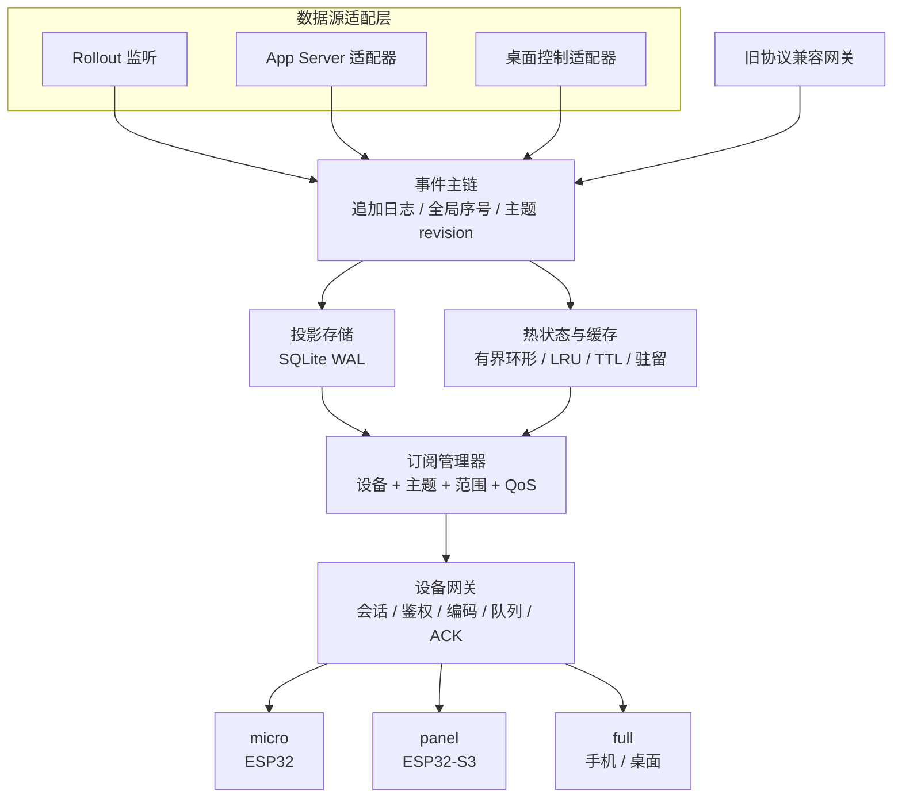

# CodexBridge CBDP v1 架构重构设计

## 1. 文档状态

- 状态：设计冻结，与 CBDP v1.0 线协议全集同步；不代表本轮全部功能已实现
- 日期：2026-10-17
- 目标版本：CodexBridge 2.0
- 协议名称：CBDP v1，CodexBridge Device Protocol v1
- 适用范围：Bridge 核心、设备协议、桌面集成、手机客户端、ESP 客户端和兼容网关

本文档是架构设计规范，不是分步实现计划。实现顺序、任务拆分和测试清单在
独立实施计划中展开。本文档中的设计全集不等于本轮实现范围；本轮可用边界必须
以 `docs/CBDP-V1-PROTOCOL.md` 的 `[本轮实现]` 和 `[本轮不实现]` 标记为准。

CBDP v1 线协议已经冻结在 `docs/CBDP-V1-PROTOCOL.md`。本文档描述 Bridge 内部
架构、投影存储、订阅、所有权和迁移边界；任何线格式或设备可见语义冲突时，
以线协议文档为准。

## 2. 背景

当前 CodexBridge 同时承担发现、设备会话、能力管理、Codex 数据采集、
companion HTTP API、桌面 IPC 集成、线程轮询、日志扫描、事件分发和旧协议
兼容等职责。随着设备种类增加，现有结构出现了以下问题：

1. `companion` 周期性枚举线程，并持续跟随桌面线程。
2. 桌面 `thread-stream-state-changed` 的完整快照进入 Bridge 后，会触发
   多轮状态发布和查询失效。
3. 线程状态同时依赖 app-server、rollout 日志和桌面 IPC，没有单一事实源。
4. 数据分发按当前手机和桌面流程设计，缺少低内存设备所需的帧长、文本、
   订阅和队列预算。
5. 协议是 JSON 行格式，扩展字段、版本演进和设备资源策略没有统一机制。
6. 旧设备、手机、ESP 和桌面客户端共享部分代码路径，但共享的不是同一个
   领域事件模型。

本设计把 Bridge 重构为事件驱动的通用设备平台。手机、ESP 和桌面客户端使用
同一套 CBDP v1 事件模型，差异通过设备 profile、能力策略和传输预算表达。

## 3. 已确认的架构决策

本节记录已经确认的边界。实现不得在未更新本文档的情况下改变这些决策。

### 3.1 破坏性协议升级

CBDP v1 是新的二进制协议，不要求旧 JSON 行协议继续作为主协议。

旧设备只通过独立兼容网关接入。兼容网关把旧协议翻译为 CBDP v1 领域事件和
命令，不复制 Bridge 核心逻辑，也不建立第二套业务状态。

### 3.2 三档设备 profile

设备分为三档默认 profile：

| Profile | 典型设备 | 主要约束 |
|---|---|---|
| `micro` | 无 PSRAM 或内存极小的 ESP32 | 小帧、短文本、无历史、只收关键事件 |
| `panel` | 带屏 ESP32-S3 或同类设备 | 当前任务摘要、有限消息、控制和审批 |
| `full` | 手机、桌面客户端 | 分页历史、完整控制面、实时状态 |

三档 profile 共享同一个事件模型、命令模型和订阅模型。profile 只影响预算、
默认能力和传输策略，不产生三套协议。

### 3.3 能力策略可插拔

设备能力采用三层求交：

```text
device.supported
∩ policy.enabled
∩ transport.allowed
= effective
```

`micro`、`panel` 和 `full` 只是默认模板。管理页面可以按设备调整：

- 可用命令和事件类型
- 最大帧长、文本长度和队列深度
- 接收完整正文、摘要或仅有状态
- 控制和审批权限
- live 订阅权限
- TLS 或局域网明文策略；帧级 AEAD 属于 `[本轮不实现]`
- 每类事件的采样、合并和保留策略
- 队列、引导、编辑/删除、结构化输入、附件、草稿、工具/MCP、上下文和活动状态

设备能力使用 64 位位图，配置页面必须按线协议第 9.2 节保存和展示全部能力组，
不能用固定字符串列表代替位图。

设备自行声明的能力不能绕过本机策略和传输策略。

### 3.4 线程所有权

Bridge 始终是唯一权威写入者。桌面 Adapter、手机和 ESP 都不能直接操作
Codex 内部写入路径，只能向 Bridge 提交写入意图。

线程按生命周期分为：

```text
UNMANAGED  已知线程，当前没有 writer lease
OBSERVED   正在同步投影，当前没有 writer lease
CLAIMED    已分配 writer lease，可提交串行化写入
MANAGED    writer lease 有效且当前写入事务正在执行
```

writer lease 是同线程串行化令牌，不改变 Bridge 的权威写入者身份。没有有效
lease 的写入必须拒绝，错误为 `WRITER_CONFLICT` 或策略要求的 `UNAUTHORIZED`。
如果观察到官方桌面绕过 Bridge 直接写入，Bridge 必须撤销该线程的 lease、
进入 resync，并广播 `thread.owner.changed`。

### 3.5 协议演进

CBDP v1 使用固定版本头和 TLV 扩展字段：

- 固定头携带 `version`、`type`、`flags`、长度和序号。
- 可选字段使用 TLV。
- 未知 TLV 必须安全跳过。
- 次版本只增加能力，不破坏既有线格式。
- 主版本变化才允许不兼容线格式变更。

### 3.6 运行时依赖

核心运行时不依赖 Redis、向量数据库或其他外部常驻服务。

保留的设计思想：

- 有界内存
- LRU、TTL 和引用计数
- 追加式事件日志
- cursor 增量恢复
- 正文和索引分离
- 小对象紧凑编码
- 大对象分段或外置存储
- 单 writer 串行化

Redis 和向量数据库不属于 CBDP v1 的实现范围。

## 4. 目标与非目标

### 4.1 目标

1. 建立单一事实源，所有设备读取同一套事件和投影。
2. 空闲时不订阅桌面线程，不产生持续 IPC 快照。
3. 低内存 ESP 可以接收、回复、审批和控制，而不下载完整历史。
4. 设备断线后从 cursor 恢复，不重复处理全部历史。
5. 内存占用与活跃设备、活跃线程和最近事件相关，而不是与历史总量相关。
6. 多设备可以并发操作，同一线程只有一个权威写入者。
7. 保持现有配对、能力和配置数据可迁移。

### 4.2 非目标

1. 不实现 Redis 兼容层。
2. 不实现向量数据库或语义检索。
3. 不在设备端保存完整聊天历史。
4. 不让 ESP 解析桌面 IPC 或 Codex app-server 原始协议。
5. 不允许任何设备或桌面 Adapter 绕过 Bridge 写入；Bridge 通过 writer lease
   保证同线程串行化，外部直写按冲突处理。
6. 不把完整 rollout 文件复制进内存或设备消息。

## 5. 总体架构



### 5.1 核心边界

`Source Adapters` 只把上游事实转换为领域事件。它们不直接向设备发送消息，
不维护设备状态，不决定事件裁剪策略。

`Event Spine` 是唯一的事实追加点。上游变化、命令结果、审批和状态变更都必须
成为事件。

`Projection Store` 保存可查询的当前状态。设备读取默认走投影，不直接查询上游。

`Hot State` 只保存活跃设备、活跃线程、最近事件、订阅引用和去重信息。

`Subscription Manager` 决定哪些设备关心哪些 topic，并根据 profile、能力和
策略真值裁剪事件。

`Device Gateway` 只处理传输、会话、编码、发送队列、ACK 和重连。

`Legacy Protocol Gateway` 只做协议转换，不做业务判断。

## 6. 领域模型

### 6.1 核心实体

```text
Device
  device_id, model, firmware, profile, supported, enabled,
  transport_security, limits, last_seen, online

Thread
  thread_id, title, status, revision, owner_state, cwd, model,
  created_at, updated_at, completed_at

Turn
  turn_id, thread_id, status, revision, started_at, completed_at,
  current_action, token_usage

Message
  message_id, thread_id, turn_id, kind, status, body_ref,
  created_at, sequence

QueueItem
  queue_item_ref, thread_id, position, state, priority,
  input_parts_ref, due_at, created_at, updated_at, revision

Guidance
  guidance_ref, thread_id, turn_id, text_ref, version,
  state, source_device, created_at, applied_at

MessageRevision
  object_ref, revision, revision_of_ref, replaced_by_ref,
  tombstone, change_origin, change_reason

InputRequest
  input_ref, thread_id, turn_id, questions_ref, blocking,
  expires_at, state, answers_ref, answered_by

Attachment
  attachment_ref, thread_id, kind, filename, mime_type,
  byte_size, content_ref, sha256, upload_state

Draft
  draft_ref, device_id, thread_id, draft_revision,
  text_ref, parts_ref, expires_at

ActiveState
  active_thread_ref, active_turn_ref, active_device_ref,
  active_revision, resume_required, resume_cursor

ThreadSettings
  thread_id, model, effort, cwd, approval_policy,
  reviewer, sandbox_policy, personality, settings_revision

ThreadGoal  `[本轮不实现]`
  goal_ref, thread_id, text_ref, status, revision

ReadState
  thread_id, device_ref, read_at_ms, unread_count, revision

McpState
  server_id, status, auth_status, reason, revision

Subscription
  device_id, topic_id, scope, qos, cursor, created_at, last_ack

Command
  request_id, idem, device_id, method, params, state, result, deadline

WriterLease
  thread_id, owner, generation, expires_at
```

### 6.2 writer lease 与线程所有权状态机

```text
UNMANAGED
  │ Bridge 发现
  ▼
OBSERVED
  │ 用户显式接管
  ▼
CLAIMED
  │ 写入开始
  ▼
MANAGED
  │ 完成或释放
  └──────────────► CLAIMED

任意状态：
  检测到桌面绕过 Bridge 写入 ──► 撤销 lease，进入 resync，降级为 OBSERVED
  用户释放 writer lease      ──► 降级为 OBSERVED
  线程无活动订阅或租约        ──► 降级为 UNMANAGED
```

所有写入意图都进入 Bridge。`CLAIMED` 和 `MANAGED` 只表示 writer lease 的
持有与执行状态；没有有效 lease 的写入返回 `WRITER_CONFLICT`。桌面绕过 Bridge
写入不是合法写入路径，而是需要撤销 lease、resync 和广播所有权变化的冲突。

### 6.3 事件类型

事件类型以线协议第 16 章为准，分为以下稳定组：

```text
0x01xx  thread
0x02xx  turn
0x03xx  message
0x04xx  approval
0x05xx  command
0x06xx  device
0x07xx  system
0x08xx  queue
0x09xx  guidance
0x0Axx  revision / edit / tombstone
0x0Bxx  thread lifecycle / settings / goal（goal 事件为 `[本轮不实现]`）
0x0Cxx  input / item / tool / MCP / notice
0x0Dxx  attachment / draft
0x0Exx  account / context / active state / search
```

实现不得只枚举基础事件后丢弃扩展事件。Bridge 根据设备 `effective_caps`
裁剪事件，设备必须能对未知但已订阅的事件安全跳过并在 ACK 中推进 cursor。

每个事件包含：

```text
event_id
global_seq
topic_id
topic_seq
revision
event_type
qos
payload
created_at
```

## 7. 事件主链

### 7.1 事件日志

事件日志使用 SQLite WAL 保存，内存中维护有界 ring buffer。

```sql
CREATE TABLE events (
    global_seq   INTEGER PRIMARY KEY AUTOINCREMENT,
    event_id     TEXT NOT NULL UNIQUE,
    topic_id     INTEGER NOT NULL,
    topic_seq    INTEGER NOT NULL,
    revision     INTEGER NOT NULL,
    event_type   INTEGER NOT NULL,
    qos          INTEGER NOT NULL,
    flags        INTEGER NOT NULL DEFAULT 0,
    payload      BLOB NOT NULL,
    created_at   INTEGER NOT NULL
);

CREATE INDEX idx_events_topic_seq ON events(topic_id, topic_seq);
CREATE INDEX idx_events_created ON events(created_at);
```

### 7.2 热事件缓存

进程内 ring buffer 保存最近事件。默认参数：

```text
event_ring_capacity = 1000
event_payload_shared = true
deep_copy_on_read = false
```

事件热记录只保存固定头、payload 偏移和引用，读取时按需反序列化。

### 7.3 日志清理

事件日志按时间和大小清理。设备 cursor 落到已清理区间时返回
`resync.required`，设备重新拉取当前快照。

默认策略：

```text
保留时间：7 天
最大事件数：100000
最大数据库大小：256 MiB
压缩：SQLite 页面复用，不保存原始大文本
```

## 8. 投影存储

### 8.1 表结构

```sql
CREATE TABLE threads (
    thread_id     TEXT PRIMARY KEY,
    title         TEXT NOT NULL,
    status        INTEGER NOT NULL,
    revision      INTEGER NOT NULL,
    owner_state   INTEGER NOT NULL,
    cwd           TEXT,
    model         TEXT,
    created_at    INTEGER NOT NULL,
    updated_at    INTEGER NOT NULL,
    completed_at  INTEGER NOT NULL DEFAULT 0,
    summary_ref   TEXT
);

CREATE TABLE turns (
    turn_id       TEXT PRIMARY KEY,
    thread_id     TEXT NOT NULL,
    status        INTEGER NOT NULL,
    revision      INTEGER NOT NULL,
    current_action TEXT,
    started_at    INTEGER,
    completed_at  INTEGER,
    token_usage   BLOB
);

CREATE TABLE messages (
    message_id    TEXT PRIMARY KEY,
    thread_id     TEXT NOT NULL,
    turn_id       TEXT,
    kind          INTEGER NOT NULL,
    status        INTEGER NOT NULL,
    body_ref      TEXT,
    created_at    INTEGER NOT NULL,
    sequence      INTEGER NOT NULL,
    revision      INTEGER NOT NULL
);

CREATE TABLE subscriptions (
    device_id     TEXT NOT NULL,
    topic_id      INTEGER NOT NULL,
    scope         INTEGER NOT NULL,
    qos           INTEGER NOT NULL,
    cursor_seq    INTEGER NOT NULL,
    last_ack_seq  INTEGER NOT NULL,
    PRIMARY KEY (device_id, topic_id, scope)
);

CREATE TABLE device_checkpoints (
    device_id     TEXT PRIMARY KEY,
    global_seq    INTEGER NOT NULL,
    updated_at    INTEGER NOT NULL
);

CREATE TABLE idempotency (
    idem          TEXT PRIMARY KEY,
    command_id    TEXT NOT NULL,
    result_ref    TEXT,
    created_at    INTEGER NOT NULL,
    expires_at    INTEGER NOT NULL
);

CREATE TABLE writer_leases (
    thread_id     TEXT PRIMARY KEY,
    owner         TEXT NOT NULL,
    generation    INTEGER NOT NULL,
    expires_at    INTEGER NOT NULL
);

CREATE TABLE queue_items (
    queue_item_ref INTEGER PRIMARY KEY,
    thread_id      TEXT NOT NULL,
    position       INTEGER NOT NULL,
    state          INTEGER NOT NULL,
    priority       INTEGER NOT NULL DEFAULT 100,
    input_parts_ref TEXT NOT NULL,
    due_at         INTEGER NOT NULL DEFAULT 0,
    created_at     INTEGER NOT NULL,
    updated_at     INTEGER NOT NULL,
    revision       INTEGER NOT NULL
);
CREATE INDEX idx_queue_thread_position
    ON queue_items(thread_id, position);

CREATE TABLE guidance (
    guidance_ref   INTEGER PRIMARY KEY,
    thread_id      TEXT NOT NULL,
    turn_id        TEXT NOT NULL,
    text_ref       TEXT NOT NULL,
    version        INTEGER NOT NULL,
    state          INTEGER NOT NULL,
    source_device  TEXT,
    created_at     INTEGER NOT NULL,
    applied_at     INTEGER NOT NULL DEFAULT 0
);
CREATE INDEX idx_guidance_turn
    ON guidance(thread_id, turn_id, state);

CREATE TABLE revisions (
    object_kind    INTEGER NOT NULL,
    object_ref     INTEGER NOT NULL,
    revision       INTEGER NOT NULL,
    revision_of_ref INTEGER,
    replaced_by_ref INTEGER,
    tombstone      INTEGER NOT NULL DEFAULT 0,
    change_origin  INTEGER NOT NULL,
    change_reason  TEXT,
    PRIMARY KEY(object_kind, object_ref, revision)
);

CREATE TABLE input_requests (
    input_ref      INTEGER PRIMARY KEY,
    thread_id      TEXT NOT NULL,
    turn_id        TEXT,
    questions_ref  TEXT NOT NULL,
    blocking       INTEGER NOT NULL,
    expires_at     INTEGER NOT NULL DEFAULT 0,
    state          INTEGER NOT NULL,
    answers_ref    TEXT,
    answered_by    TEXT
);

CREATE TABLE attachments (
    attachment_ref INTEGER PRIMARY KEY,
    thread_id      TEXT NOT NULL,
    kind           INTEGER NOT NULL,
    filename       TEXT,
    mime_type      TEXT,
    byte_size      INTEGER NOT NULL,
    content_ref    TEXT NOT NULL,
    sha256         BLOB NOT NULL,
    upload_state   INTEGER NOT NULL,
    revision       INTEGER NOT NULL
);

CREATE TABLE drafts (
    draft_ref      INTEGER PRIMARY KEY,
    device_id      TEXT NOT NULL,
    thread_id      TEXT NOT NULL,
    draft_revision INTEGER NOT NULL,
    text_ref       TEXT,
    parts_ref      TEXT,
    expires_at     INTEGER NOT NULL DEFAULT 0
);

CREATE TABLE active_state (
    singleton      INTEGER PRIMARY KEY CHECK(singleton = 1),
    active_thread_ref INTEGER NOT NULL DEFAULT 0,
    active_turn_ref   INTEGER NOT NULL DEFAULT 0,
    active_device_ref INTEGER NOT NULL DEFAULT 0,
    active_revision   INTEGER NOT NULL DEFAULT 0,
    resume_required   INTEGER NOT NULL DEFAULT 0,
    resume_cursor     INTEGER NOT NULL DEFAULT 0
);

CREATE TABLE thread_settings (
    thread_id       TEXT PRIMARY KEY,
    model           TEXT,
    effort          TEXT,
    cwd             TEXT,
    approval_policy INTEGER,
    reviewer        INTEGER,
    sandbox_policy  INTEGER,
    personality     TEXT,
    settings_revision INTEGER NOT NULL,
    metadata_json   TEXT
);

-- [本轮不实现]：保留完整设计，当前不得启用 thread_goal 能力。
CREATE TABLE thread_goals (
    goal_ref  INTEGER PRIMARY KEY,
    thread_id TEXT NOT NULL UNIQUE,
    text_ref  TEXT,
    status    INTEGER NOT NULL,
    revision  INTEGER NOT NULL
);

CREATE TABLE read_states (
    thread_id    TEXT NOT NULL,
    device_id    TEXT NOT NULL,
    read_at      INTEGER NOT NULL DEFAULT 0,
    unread_count INTEGER NOT NULL DEFAULT 0,
    revision     INTEGER NOT NULL,
    PRIMARY KEY(thread_id, device_id)
);

CREATE TABLE mcp_state (
    server_id   TEXT PRIMARY KEY,
    status      INTEGER NOT NULL,
    auth_status INTEGER NOT NULL,
    reason      TEXT,
    revision    INTEGER NOT NULL
);
```

### 8.2 正文化

短消息可以内联保存。长消息、assistant 全文和大工具输出保存到内容表或文件，
通过 `body_ref` 引用。

```text
短文本：直接存 SQLite TEXT
中等文本：SQLite BLOB 或压缩文本
长文本：内容文件 + 偏移 + 长度
rollout：只保存路径、偏移和水位，不复制全文
```

设备读取列表时只读 `threads` 和少量 `messages` 元数据，不加载正文。

## 9. 内存模型与紧凑布局

### 9.1 内存分层

```text
L0  活跃会话和当前 turn
L1  最近事件 ring、订阅表、去重表
L2  线程和消息投影缓存
L3  SQLite WAL 持久事实
L4  rollout 文件、归档和 mmap
```

内存预算目标：

```text
内存 = 活跃设备 + 活跃线程 + 最近事件 + 有界缓存
```

历史和冷消息不得常驻内存。

### 9.2 字符串驻留

重复出现的字符串统一驻留为数值 ID：

```text
thread_id  -> u32
device_id  -> u32
turn_id    -> u32
event_type -> u16
method     -> u16
```

事件和缓存记录内部不重复保存字符串。

### 9.3 Arena 事件头

事件热记录使用连续 arena：

```text
offset  size  field
0       4     event_type_and_flags
4       4     topic_id_and_qos
8       8     global_seq
16      4     revision
20      4     payload_offset
24      4     payload_length
28      4     created_at_delta
```

固定部分控制在 32 字节以内，文本和 JSON 不进入热头。

### 9.4 自适应集合布局

借鉴 Redis 的紧凑编码思想，按元素数量和元素宽度升级布局：

```text
InlineSet    少量元素，连续数组，线性扫描
SegmentedVec 中等规模，分段存储，不复制大块
HashIndex    大规模，哈希索引指向 arena
Bitmap       固定范围 ID 集合，用于订阅和已读水位
```

默认升级策略由配置决定，不写死为单一字节阈值：

```text
元素 <= 8 且元素宽度 <= 8   -> InlineSet
元素 <= 32                 -> SegmentedVec
更大集合                   -> HashIndex
固定 ID 集合               -> Bitmap
```

### 9.5 消息缓存

`MessageStore` 不再使用无界 `OrderedDict[str, MessageRecord]`。

新模型：

```text
MessageMeta   固定元数据，进入有界 LRU
MessageBody   正文外置，按需读取
ReadState     整数水位或 bitmap
```

默认缓存：

```text
thread_summary_cache = 256
messages_per_thread = 50
global_message_meta = 4096
idempotency_cache = 10000
```

### 9.6 内存压力阶梯

```text
70%  合并 state 事件，停止推送 telemetry
80%  清理冷线程 projection
90%  取消无 live 引用的桌面 follow
95%  只保留 critical 事件和活跃 turn
```

内存压力处理不得丢失审批、失败和最终完成事件。

## 10. CBDP v1 协议

### 10.1 传输

CBDP v1 支持以下 transport：

| Transport | 用途 |
|---|---|
| TCP binary frame | ESP 默认，低开销 |
| TCP + TLS | micro、panel、full 中支持 TLS 的设备 |
| WebSocket binary | 手机和浏览器 |
| SSE/HTTP | 手机兼容路径，映射为 CBDP 事件 |
| Legacy TCP JSON | 只经兼容网关，不作为新实现路径 |

同一逻辑消息可以在不同 transport 上有不同编码，但语义必须一致。

### 10.2 帧格式

固定头：

```text
offset  size  field
0       2     magic = 0xCB01
2       1     version_major
3       1     message_type
4       2     flags
6       2     header_len
8       4     payload_len
12      4     topic_id
16      4     seq
20      4     ack_seq
24      2     code
26      1     qos
27      1     reserved
28      ...   TLV extension
```

固定头共 28 字节。`header_len` 包含 TLV 区。`payload_len` 不包含固定头。

TLV：

```text
tag: u16
len: u16
value: len bytes
```

未知 tag 必须跳过，不得导致连接关闭。

### 10.3 消息类型

```text
0x01 HELLO
0x02 WELCOME
0x03 AUTH
0x04 AUTH_OK
0x05 PING
0x06 PONG
0x07 SUBSCRIBE
0x08 UNSUBSCRIBE
0x09 SNAPSHOT
0x0A DELTA
0x0B ACK
0x0C RESYNC
0x0D COMMAND
0x0E RESULT
0x0F ERROR
0x10 SEND_BEGIN
0x11 SEND_CHUNK
0x12 SEND_END
0x13 AUDIO_BEGIN
0x14 AUDIO_CHUNK
0x15 AUDIO_END
0x16 APPROVAL_REQUEST
0x17 APPROVAL_RESOLVE
0x18 DEVICE_STATUS
0x19 CAPABILITY_UPDATE
0x1A CLOSE
0x1B FRAGMENT
0x1C DISCOVERY
0x1D DISCOVERY_REPLY
```

`0x1E` 和 `0x1F` 保留。未知消息类型不得按已知类型解析。

### 10.4 握手

握手流程：

```text
设备 -> HELLO
Bridge -> WELCOME
设备 -> AUTH
Bridge -> AUTH_OK
双方 -> PING / PONG
```

心跳只发送 `PING` 或 `PONG`，不再重复发送完整能力和版本。

### 10.5 profile 预算

| 项目 | micro | panel | full |
|---|---:|---:|---:|
| 默认最大帧 | 256 B | 1024 B | 64 KiB |
| 最大文本 | 160 chars | 512 chars | 分页或流式 |
| 历史消息 | 0 | 1-2 条 | 分页 |
| 默认心跳 | 30 s | 15 s | 10 s |
| 发送队列 | 8 | 32 | 256 |
| live 订阅 | 可选 | 可选 | 允许 |
| 音频 | 可选 | 可选 | 允许 |

这些值都是默认模板，管理页面可以按设备覆盖。

### 10.6 订阅 scope 和 QoS

```text
scope:
  summary   列表摘要
  thread    当前线程详情
  live      实时 turn 和审批

qos:
  critical  必须确认，不可静默丢弃
  state     可以合并，最新状态覆盖旧状态
  telemetry 可以采样或丢弃
```

只有存在 `live` 订阅时，Bridge 才允许建立桌面线程 follow。

### 10.7 回复对话

设备不直接发送 `turn.start` 或 `turn.steer`。设备使用统一高层语义：

```text
SEND_BEGIN(tx, idem, thread_id, mode=auto)
SEND_CHUNK(tx, offset, data)
SEND_END(tx)
```

Bridge 根据线程状态和 writer lease 决定：

```text
线程空闲           -> turn.start
线程运行中         -> turn.steer
线程有 lease 且忙碌 -> 排队或返回 busy
线程无有效 lease    -> 按策略进入认领流程或返回 writer conflict
```

同一个 `idem` 只能产生一个 turn。

### 10.8 音频回复

`micro` 和 `panel` 可以上传音频，但不在设备端保存完整历史。

```text
AUDIO_BEGIN
AUDIO_CHUNK
AUDIO_END
  -> Bridge 侧 STT
  -> 转换为 SEND_* 语义
```

ESP 只负责采集和流式上传，不负责大模型调用和完整上下文拼接。

### 10.9 错误码

```text
OK
NOT_FOUND
BUSY
UNAUTHORIZED
CAPABILITY_NOT_ENABLED
INVALID_FRAME
INVALID_PARAM
INVALID_STATE
IDEMPOTENCY_CONFLICT
STALE_CURSOR
RESYNC_REQUIRED
UPSTREAM_UNAVAILABLE
WRITER_CONFLICT
PAYLOAD_TOO_LARGE
UNSUPPORTED_FEATURE
TIMEOUT
POLICY_DENIED
REVISION_CONFLICT
DUPLICATE
RATE_LIMITED
CANCELLED
INTERNAL
PROTOCOL_VERSION
AUTH_EXPIRED
TOKEN_ROTATED
QUEUE_FULL
FRAGMENT_ERROR
CONTENT_UNAVAILABLE
```

错误码数值、重试语义和响应格式以线协议第 21 章为准；这里只列架构实现需要
覆盖的集合。

## 11. 订阅管理器

### 11.1 订阅键

```text
(device_id, topic_id, scope, qos)
```

引用计数按 `topic_id + scope` 维护。只有 live 引用计数大于零时，Bridge
才允许向桌面请求线程流。

### 11.2 分发流程

```text
Event published
  -> resolve topic subscribers
  -> filter effective capabilities
  -> apply profile budget
  -> coalesce by QoS
  -> write device queue
  -> send
  -> receive ACK
  -> advance cursor
```

### 11.3 设备队列

每个设备独立有界队列：

```text
micro:  8
panel: 32
full:  256
```

慢设备不得阻塞其他设备，也不得阻塞 Event Spine。

### 11.4 重连恢复

设备不发送独立的 `RESUME` 消息；CBDP v1 没有该消息类型。设备重连后执行：

1. 重新完成 HELLO / WELCOME / AUTH / AUTH_OK。
2. 对每个订阅键发送带 `cursor` 的 `SUBSCRIBE`。
3. Bridge 从 checkpoint 后回放增量事件。
4. 如果 cursor 已不可恢复，Bridge 返回 `RESYNC_REQUIRED` 或事件
   `resume.required`，设备重新订阅并从 `SNAPSHOT` 恢复。
5. 设备也可以调用 `events.since` 批量拉取事件窗口。

业务恢复只使用 `cursor`，传输层 `seq` 每次重连从 1 重新开始。

## 12. 设备网关

### 12.1 会话状态

```text
DISCONNECTED
CONNECTED
HELLO_RECEIVED
AUTHENTICATED
READY
STALE
```

### 12.2 鉴权与安全

安全策略可按设备配置：

```text
pairing_token
hmac_sha256
tls
plain_lan_debug
```

CBDP v1 保留帧级 AEAD 编号，但它属于 `[本轮不实现]`。需要加密的 micro、`panel` 和 full 设备本轮统一使用 TLS；
`aead_reserved` 能力位必须保持 0。安全策略必须在管理页面可配置，并且不能
绕过本机策略。

### 12.3 能力协商

```text
设备声明 supported
配置页面设置 enabled
transport 决定 allowed
Bridge 返回 effective
```

`CAPABILITY_UPDATE` 可以实时调整，无需重连。

## 13. 控制与写入

### 13.1 显式接管

用户必须在管理页面或客户端显式点击“接管线程”。接管流程：

```text
检查线程是否存在
检查是否有活动 writer
检查是否有运行中的 turn
创建 writer lease
将线程状态改为 CLAIMED
发布 thread.owner.changed
```

### 13.2 多设备命令

所有命令使用 `request_id + idem`。

```text
request_id  设备本地请求编号
idem        全局幂等键
```

重试只返回原结果，不重复执行。命令结果分为：

```text
accepted    已接收，后台执行
completed   执行完成
failed      执行失败
```

### 13.3 审批

审批采用 first-valid-response-wins。第一个有效响应生效，其余设备收到
`approval.resolved`。

## 14. 上游适配器

### 14.1 RolloutWatcher

职责：

- 监听 rollout 文件变化
- 保存文件偏移和半行缓冲
- 只解析新增 JSONL
- 将生命周期事件转换为领域事件

不得：

- 每次轮询读取整个文件
- 把 rollout 文件当唯一协议
- 把长文本直接放入热内存

### 14.2 AppServerAdapter

职责：

- 按需读取线程、turn、模型和账号信息
- 执行 Bridge 持有 lease 的写入
- 处理 app-server 连接和错误

不得：

- 周期性全量枚举线程
- 在读取状态下启动第二个 writer
- 在设备请求路径中长时间阻塞

### 14.3 DesktopControlAdapter

职责：

- 发现桌面 owner
- 审批和控制信号路由
- 仅对 live 订阅线程 follow

不得：

- 跟随所有桌面线程
- 把完整 snapshot 直接广播给设备
- 把桌面私有协议暴露给设备

## 15. 兼容网关

### 15.1 目标

旧 JSON 行协议设备继续可用，但只通过兼容网关进入系统。

### 15.2 映射

```text
旧 bridge_auth       -> HELLO + AUTH
旧 bridge_ready      -> WELCOME + CAPABILITY_UPDATE
旧 message           -> SNAPSHOT / DELTA
旧 device_event      -> COMMAND
旧 command_result    -> RESULT
旧 protocol_catalog  -> DEVICE_STATUS + capability catalog
```

### 15.3 限制

- 兼容网关不实现新功能。
- 兼容网关不绕过 writer lease。
- 兼容网关可以降低事件频率和文本长度。
- 兼容网关只维护翻译状态，不维护第二套业务状态。

### 15.4 退出策略

兼容网关是过渡通道。未来主版本可以移除，但必须先提供迁移指南和设备固件建议。

## 16. 配置与管理页面

管理页面新增设备策略编辑：

```text
能力
  64 位能力位图，按线协议 9.2 分组显示
  status/text/tasks/results/approval/audio/voice/control/read_ack/history
  queue/queue_manage/guidance/message_edit/message_delete
  structured_input/attachment/draft/batch/tool_events/mcp
  account/context_usage/context_compact/read_unread
  cross_device_active/resume/events_since/thread_goal

配置页面按完整协议全集展示能力组。`batch`、`context_compact`、`thread_goal`、
`structured_approval`、`interrupt_mode`、`compression`、`aead_reserved`、
`vendor`、`experimental_ext` 和 `realtime_reserved` 必须显示为
`[本轮不实现]`，不得作为本轮可勾选的当前功能。

资源
  max_frame_bytes
  max_text_chars
  max_text_bytes
  queue_depth
  heartbeat_seconds
  history_depth
  max_subscriptions
  max_audio_bytes
  snapshot_page_objects
  max_chunk_bytes
  window_frames
  window_bytes

同步
  summary / thread / live
  critical / state / telemetry
  coalesce_window_ms

安全
  pairing_token / hmac / tls / plain_lan_debug
```

策略修改后通过 `CAPABILITY_UPDATE` 推送给设备。设备不需要重连，除非
传输安全级别发生变化。

## 17. 故障处理

### 17.1 上游断开

- Event Spine 继续服务已持久化投影。
- AppServerAdapter 和 DesktopControlAdapter 指数退避重连。
- 持有 writer lease 的线程到期后进入安全状态。
- 无租约线程只反映投影中的最后一次已知状态，不开放写入快路径。

### 17.2 设备断开

- 保留 checkpoint 和订阅策略。
- 队列有界，超出的 state 事件可以合并。
- critical 事件持久化，等待设备恢复。
- 设备恢复后从 cursor 增量同步。

### 17.3 事件缺口

检测到 cursor 落后于已清理范围：

```text
RESYNC_REQUIRED
  -> 设备请求 SNAPSHOT
  -> 从 Projection Store 读取当前状态
  -> 恢复订阅
```

### 17.4 writer 冲突

检测到任何桌面 Adapter 绕过 Bridge 直接写入：

```text
撤销该线程 writer lease
若存在进行中的 Bridge 写入事务，先安全终止或等待其结束
线程降级为 OBSERVED
发布 thread.owner.changed
通知订阅设备重新同步
```

## 18. 性能目标

### 18.1 空闲状态

- 桌面 live follow 数：0
- 桌面主进程 CPU：接近关闭 Bridge 时的基线
- 桌面渲染进程 CPU：接近关闭 Bridge 时的基线
- Bridge 事件队列：无持续增长
- ESP 只接收心跳和必要状态变化

### 18.2 活跃状态

- 活跃线程投影只保留当前线程和必要的最近消息。
- 大 rollout 文件按偏移增量读取。
- 设备事件合并窗口默认 100 到 300 ms。
- `critical` 事件不进入合并窗口。

### 18.3 内存目标

```text
空闲 Bridge 常驻内存：< 100 MiB
活跃 10 个设备 + 5 个线程：< 200 MiB
171 MiB rollout 线程变化：处理成本与新增内容成正比
```

最终数值以实现后的实测为准，但不得随全部历史线性增长。

## 19. 测试策略

### 19.1 协议测试

- 固定头编码和解码
- TLV 未知字段跳过
- 帧长和字段边界
- 分片、乱序和重复帧
- 错误码
- 握手和鉴权

### 19.2 事件和投影测试

- 事件追加顺序
- revision 单调递增
- snapshot 到 delta
- cursor 恢复
- 事件清理后 resync
- projection 重建
- queue / guidance / revision / attachment / draft / active-state 投影恢复
- 多设备已读、线程设置、goal（`[本轮不实现]`）和 MCP 状态重建
- content body 外置后按 `content.read` 分页读取

### 19.3 设备 profile 测试

- micro 不接收历史
- panel 只接收有限消息
- full 可以分页读取
- 能力求交
- 策略变更实时生效
- 慢设备不阻塞其他设备

### 19.4 所有权测试

- 显式接管
- writer lease
- 桌面绕过 Bridge 写入冲突
- 多设备同时命令
- 审批 first-valid-response-wins
- 幂等重试
- 所有桌面写入都必须进入 Bridge；任何外部直写都被视为 writer 冲突
- 旧 lease generation 无法释放或覆盖新 lease

### 19.5 性能测试

- 100 个历史线程、0 个 live 订阅
- 1 个 live 订阅和 171 MiB rollout
- 10 个设备混合 profile
- 高频 state 事件合并
- 设备断线重连
- 内存压力阶梯

### 19.6 兼容测试

- 旧 JSON 行协议握手
- 旧消息映射
- 旧能力限制
- 旧设备与新设备同时在线

## 20. 迁移阶段

### Phase 0：基线测量

- 记录 Bridge 关闭时的桌面 CPU 和内存。
- 记录 Bridge 开启时的桌面 CPU 和内存。
- 记录空闲、单 live、多个 live 三种场景。
- 记录当前事件数量和 rollout 大小。

### Phase 1：事件与投影

- 新增 Event Spine。
- 新增 SQLite 投影。
- 将线程摘要和消息读取切换到投影。
- 保留现有设备协议，先用事件模型驱动它。

### Phase 2：订阅和所有权

- 引入 Subscription Manager。
- 引入 writer lease 和显式接管。
- 桌面 follow 只允许 live 订阅。
- 空闲状态停止桌面线程 follow。

### Phase 3：CBDP v1

- 实现二进制帧、TLV、profile 和能力求交。
- 先接入新固件和测试设备。
- 手机客户端通过 transport adapter 迁移。

### Phase 4：兼容网关

- 旧协议接入兼容网关。
- 旧设备继续工作。
- 新功能只进入 CBDP v1。

### Phase 5：清理旧路径

- 删除周期性 `list_threads(limit=80)`。
- 删除全量桌面 snapshot 广播。
- 删除无界消息缓存。
- 删除旧协议的内部业务分支。

## 21. 验收标准

以下条件全部满足才算架构重构完成：

1. CBDP v1 固定头、TLV 和错误码有独立测试。
2. micro、panel、full 三档 profile 共享同一事件模型。
3. 设备能力可以在管理页面配置，并通过 `CAPABILITY_UPDATE` 实时生效。
4. 空闲状态下桌面 live follow 数为 0。
5. 空闲状态下 Bridge 和桌面 CPU 接近基线。
6. 只有显式接管的线程允许 Bridge 写入。
7. 多设备命令通过 `idem` 保证幂等。
8. 审批、完成和失败事件不会丢失。
9. ESP 可以在不上传或下载完整历史的情况下回复对话。
10. 设备断线后可以从 cursor 恢复，不可恢复时进入 resync。
11. 内存占用不随历史会话总量线性增长。
12. 旧设备通过兼容网关继续可用，并且不引入第二套业务状态。
13. 完整测试套件通过，协议文档同步更新。
14. 线协议第 8.12 节全部对象 schema 都有编解码测试。
15. 架构文档与线协议在消息类型、错误码、能力位、AEAD 和恢复流程上无冲突。
16. 设备端可以只依赖线协议文档实现 micro、panel 或 full 客户端，不需要 Bridge
    内部实现细节或桌面 IPC 知识。

## 22. 实施顺序

推荐按依赖顺序实施：

1. Event Spine、事件类型和 SQLite schema。
2. Projection Store 和读取迁移。
3. RolloutWatcher 和 AppServerAdapter 边界。
4. Subscription Manager 和 writer lease。
5. CBDP v1 codec、帧和 TLV。
6. Device Gateway、profile 和策略求交。
7. micro、panel、full 客户端适配。
8. Legacy Protocol Gateway。
9. 删除旧轮询、全量 follow 和无界缓存。
10. 性能验证和发布。
11. 对照线协议第 8.12 节补齐所有对象 schema 的编码器和 Fuzz 测试。
12. 对照架构第 8.1 节补齐投影表后再启用对应能力位，禁止先宣告能力后落存储。

每一步都必须有独立测试，不得等到最后才验证。

## 23. 结论

CBDP v1 的目标不是给现有协议增加设备类型，而是把 CodexBridge 从状态轮询和
全量转发重构为通用事件平台。

重构后：

- 上游只产生事实。
- Bridge 负责规范化、持久化和投影。
- 设备只订阅自己需要的事实。
- 桌面只提供控制信号和 live 线程状态。
- 低内存设备通过小帧、小队列和低历史深度参与完整对话。
- 旧设备通过兼容网关平滑过渡。

核心原则：

```text
单一事实源
事件驱动
显式订阅
按设备预算分发
有界内存
可迁移兼容
```
